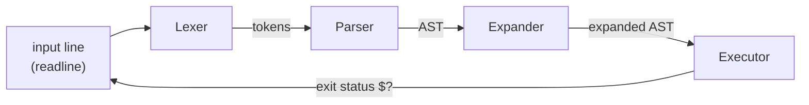
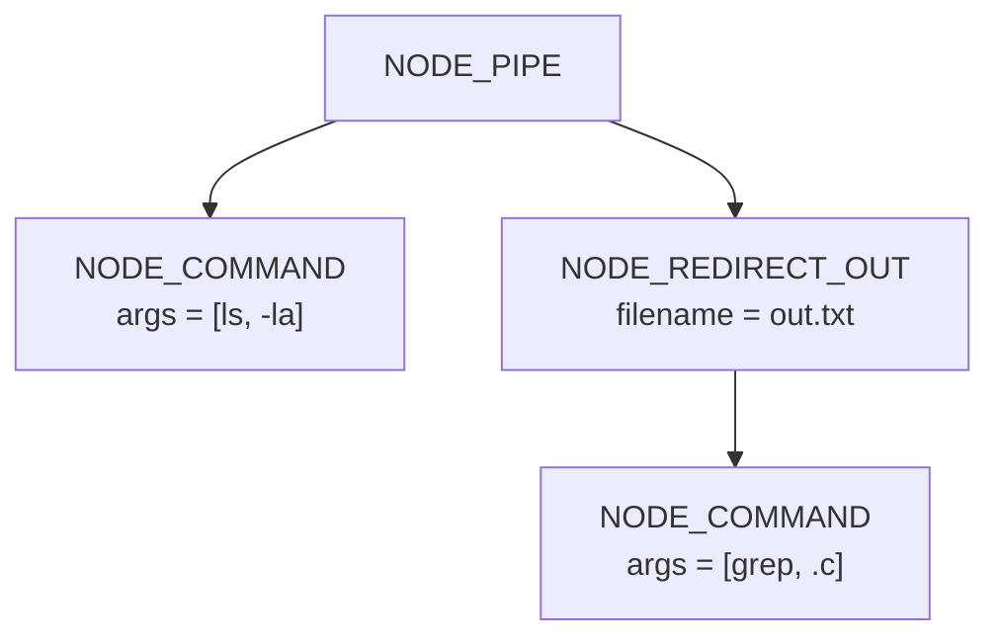
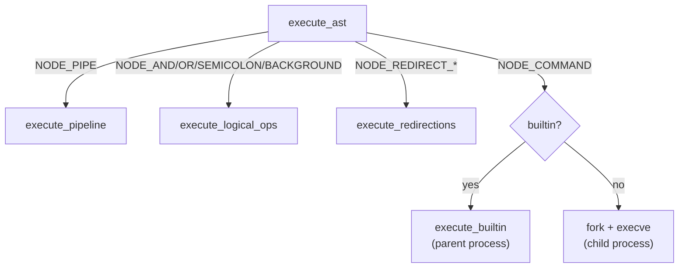

# minishell

[](https://github.com/Kizuna42/minishell/actions/workflows/ci.yml)


A bash-subset shell written from scratch in C, built as a [42](https://42tokyo.jp/) school
project. It turns a command line into an **AST** through a lexer/parser split and walks the
tree to execute pipelines, redirections, here-documents, variable expansion, quoting, and
seven builtins with proper signal handling — plus `&&` / `||` / `;` and `*` globbing as bonus.

<p align="center">
  
</p>

For the full design write-up (grammar, data structures, execution model, memory ownership,
known deviations from bash) see **[docs/ARCHITECTURE.md](docs/ARCHITECTURE.md)**.

---

## Overview

`minishell` re-implements a subset of `bash` as a tree-walking interpreter. Each input line is
processed in three stages — **lex → parse → execute** — and the underlying process model uses
standard POSIX primitives (`fork`, `execve`, `pipe`, `dup2`, `waitpid`).

- Source: ~4,300 lines across 60 `.c` files under `src/` (plus a small self-written `libft`).
- Built with `-Wall -Wextra -Werror` and kept 42-Norm compliant (function length, file
  length, argument count limits), which is why functionality is split into many small,
  single-purpose files.
- CI (`.github/workflows/ci.yml`) builds the mandatory and bonus targets and runs the test
  suite on every push/PR to `main`.
- The behavioural test suite (`test.sh`, run via `make test`) compares `minishell` output
  against real `bash` for 26 cases covering command execution, pipes, redirections, variable
  expansion, builtins, and the bonus logical/wildcard operators.

## Features

- **Command execution** — external commands resolved via `PATH` and run with `fork`/`execve`.
- **Builtins** — run in the parent process when no pipeline is present; pipeline stages run
  in forked child processes: `echo` (with `-n`), `cd`, `pwd`, `export`, `unset`, `env`, `exit`.
- **Pipelines** — arbitrary `cmd1 | cmd2 | ...` chains via `pipe(2)` + `dup2(2)`.
- **Redirections** — `<`, `>`, `>>`, and `<<` (here-document).
- **Variable expansion** — `$VAR`, `$?`, `$$`, tilde expansion, with quoting rules that match
  bash (single quotes are literal, double quotes expand `$` but not globs).
- **Signal handling** — `Ctrl-C` resets the prompt and sets `$?` to 130 (bash-compatible),
  `Ctrl-\` is ignored while interactive, and both are restored to default behaviour inside
  child processes so signals reach the running command.
- **Bonus: control operators** — `&&`, `||`, `;`, and `&`. A single `&&` or `||` short-circuits;
  mixed logical chains have a documented associativity difference from `bash` (see [Notes](#notes)).
- **Bonus: wildcards** — `*` glob expansion for unquoted words.

## Architecture & Implementation



| Layer | Directory | Responsibility |
| --- | --- | --- |
| REPL | `src/main.c`, `src/main_utils.c` | Prompt loop, line reading, FD backup/restore |
| Lexer | `src/lexer/` | String → token list; quote and operator recognition |
| Parser | `src/parser/` | Tokens → AST via recursive descent; syntax validation |
| Executor | `src/executor/` | AST traversal; process control, pipes, redirections, builtins, heredoc |
| Utils | `src/utils/` | Variable expansion, quote removal, environment, globbing, signals, cleanup |
| Bonus | `src/bonus/` | `&&` / `\|\|` / `;` control operators, `*` glob |

### Grammar and AST

Operator precedence is expressed by the nesting of the recursive-descent parser functions
(lowest precedence first):

```text
control   := pipeline (('&&' | '||' | ';' | '&') control)?
pipeline  := command ('|' command)*
command   := (WORD | redirection)*
redirect  := ('<' | '>' | '>>' | '<<') WORD
```

All four control operators share one parser level. The right operand recurses into `control`,
so chains are right-associative in the current implementation.

`ls -la | grep .c > out.txt` becomes:



Syntax validation (`validate_syntax()`) runs before execution and rejects things like
consecutive pipes, a trailing operator, or a missing redirection target without side effects.

### Core data structures (`includes/minishell.h`)

```c
typedef struct s_token {        // lexer output (linked list)
    t_token_type    type;       // WORD / PIPE / REDIRECT_* / AND / OR / SEMICOLON / BACKGROUND
    char            *value;
    int             quote_type; // QUOTE_NONE / SINGLE / DOUBLE
    struct s_token  *next;
} t_token;

typedef struct s_ast_node {     // parser output (binary tree)
    t_node_type         type;   // COMMAND / PIPE / REDIRECT_* / AND / OR / SEMICOLON / BACKGROUND
    char                **args; // argv for a COMMAND node
    char                *filename; // target file / heredoc delimiter for a REDIRECT node
    struct s_ast_node   *left;
    struct s_ast_node   *right;
} t_ast_node;

typedef struct s_minishell {    // shell-wide state
    t_env   *env_list;          // environment (linked list)
    char    **envp;             // startup snapshot passed to execve(2)
    int     last_exit_status;   // $?
    int     stdin_backup;
    int     stdout_backup;
} t_minishell;
```

The environment is kept both as a linked list and as a `char **` array. Builtins and variable
expansion read the mutable list. `env_to_array()` creates the array at startup, but the current
implementation does not rebuild it after `export`/`unset`; external commands therefore receive
the startup environment snapshot (see [Notes](#notes)).

### Execution dispatch



- **External commands** — `find_command_path()` resolves the binary against `PATH`, then
  `fork()` → `execve()` → `waitpid()`, feeding the exit status back into `$?`.
- **Builtins** — run in the *parent* process when there is no pipeline around them, because
  `cd` / `export` / `unset` / `exit` need to mutate the shell's own state; running them in a
  forked child would make the change invisible to the parent shell. When used as a pipeline
  stage, a builtin runs in a forked child like every other stage.
- **Pipelines** — each stage of `cmd1 | cmd2 | ...` is forked, with `dup2(2)` wiring stdin/
  stdout through a `pipe(2)`; the parent closes its copies of both ends and waits for every
  child.
- **Redirections** — `stdin`/`stdout` are saved to `stdin_backup`/`stdout_backup`, replaced via
  `open` + `dup2`, and restored after the command runs.
- **Heredoc (`<<`)** — content is read line-by-line from the controlling terminal and written
  into a `pipe(2)`, whose read end becomes the command's stdin; an unquoted delimiter still
  expands `$VAR` inside the body, matching bash.

### Memory and signals

- Tokens and the AST are built and freed once per input line (`free_tokens()`, `free_ast()`);
  the project is developed against `valgrind --leak-check=full`.
- File descriptors touched by a redirection are always restored via `restore_std_fds()`.
- `g_signal_status` is the project's single global (required to stay `volatile sig_atomic_t`
  and async-signal-safe inside the `SIGINT` handler); everything else lives in `t_minishell`.

## Build & Usage

### Requirements

- `cc` and GNU `readline` (headers + library).
- On macOS, the `Makefile` auto-detects a Homebrew `readline` install (`brew --prefix
  readline`) and adds its include/lib paths; on Linux (the 42 evaluation environment and CI)
  the system `readline` is used as-is.

### Build

```bash
make          # mandatory part -> ./minishell
make bonus    # + logical operators and wildcards -> ./minishell_bonus
make re       # fclean && all
make clean    # remove object files
make fclean   # remove object files and binaries
```

### Test

```bash
make test                              # build, then compare ./minishell against bash (26 cases)
MINISHELL=./minishell_bonus bash test.sh   # run the suite against an arbitrary binary
valgrind --leak-check=full ./minishell     # manual leak check
```

`test.sh` pipes each case's input into both `minishell` and `bash` and diffs stdout. Heredoc is
excluded from the automated comparison because it reads from the controlling terminal (see
[docs/ARCHITECTURE.md](docs/ARCHITECTURE.md) for details) and is instead verified interactively.

### Run

```bash
./minishell
```

At the `minishell$` prompt, input works like an interactive bash session within the supported
subset:

```bash
minishell$ ls | grep .c | wc -l
minishell$ echo "hello $USER" > out.txt
minishell$ cat << EOF
> multi-line
> input
> EOF
minishell$ true && echo ok
minishell$ false || echo recovered
minishell$ echo *.c
```

| Builtin | Description | Example |
| --- | --- | --- |
| `echo` | Print arguments (`-n` suppresses the trailing newline) | `echo -n "no newline"` |
| `cd` | Change directory | `cd /path/to/dir` |
| `pwd` | Print the working directory | `pwd` |
| `export` | Set/list environment variables | `export VAR=value` |
| `unset` | Remove an environment variable | `unset VAR` |
| `env` | List environment variables | `env` |
| `exit` | Exit the shell | `exit [code]` |

## Notes

Known differences from bash (see [docs/ARCHITECTURE.md](docs/ARCHITECTURE.md), §8, for more
implementation context):

- `&&`, `||`, `;`, and `&` share one parser level and are right-associative. Mixed chains such
  as `false && echo no || echo yes` can therefore differ from `bash`; use separate commands
  when left-to-right shell semantics matter.
- `export`/`unset` update the shell's linked-list environment used by builtins and expansion,
  but the `execve(2)` array remains the startup snapshot. An external command such as
  `/usr/bin/env` does not observe those later mutations.

- Heredoc reads its body from the controlling terminal, so piping an entire script into
  `minishell`'s stdin (e.g. `printf '... << EOF ...' | minishell`) will not feed the heredoc
  body; interactive use and `make test` behave as expected.
- Job control (`fg`/`bg`/full `&` job management) is not implemented.
- Arithmetic expansion `$(())` and command substitution `$(...)` are out of scope for this
  project.

Licensed under the [MIT License](LICENSE).
